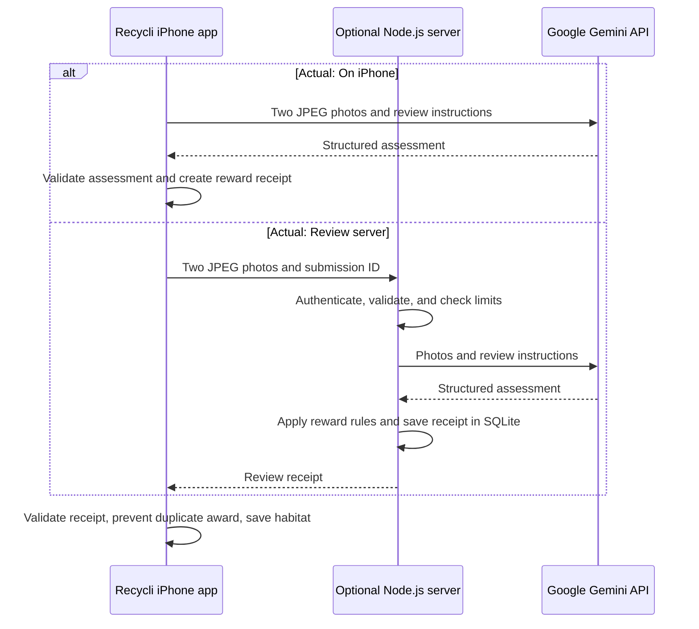

# Recycli 🌱

A pixel-art habitat game that encourages recycling through virtual pets, cleanup, and rewards. Built for the CodeRED environment track with separate Swift/SwiftUI and React Native/Expo apps.

Capture a bin and an item, earn leaves, and care for three habitats: **Willow Grove**, **Coral Cove**, and **Snow Glade**. Friends roam, react to petting, and enjoy snacks; decorations can be moved and locked in place.

**This is a hackathon prototype.** It starts in offline **Demo** mode, which simulates acceptance. **Actual** mode uses Gemini to assess a likely recycling match from photos. Neither mode proves disposal or downstream recycling.

[Run the app](#run-the-app) · [AI integration](#ai-integration) · [Architecture and backend](#architecture-and-backend) · [Developer mode](#developer-mode) · [Validation](#validation)

The `prototype-2` integration combines main at `a3f557c` with prototype at `aa65368`. It retains Recycli branding, direct Gemini on iPhone, the two-photo visual-match flow, and the React Native feature additions in Swift.

## Choose your app and phone

| Device | React Native / Expo (`mobile/`) | Swift / SwiftUI (`Recycli/`) |
| --- | --- | --- |
| iPhone | Expo Go compatible with SDK 57, or a signed iOS build | iOS 17+; Xcode on Mac or xtool on Windows/WSL |
| Android | Expo Go or an Android build | Not supported |
| Browser | Development preview; native maps/camera/sharing differ | Not supported |
| Development computer | Windows, macOS or Linux can serve Expo to either phone | macOS/Xcode, or Windows/WSL with xtool for physical iPhone builds |

These are separate implementations with separate local saves. Expo Go opens the React Native app; use Xcode or xtool to install Swift. The Expo app uses React 19.2.3, React Native 0.86.3 and Expo SDK 57, with AsyncStorage, SecureStore, Expo Camera/Audio/Haptics/Location and react-native-maps. Swift uses SwiftUI, Combine, AVFoundation, MapKit/Core Location, UserDefaults and Keychain. Both can use the optional Node.js/SQLite server. **Swift also supports a personal Gemini key directly on the iPhone; React Native AI review uses the server.** See the [stack and device setup guide](mobile/README.md).

## What you can do

- Explore three animated habitats with pollution-dependent scenery, twelve pets, and a shared leaf wallet.
- Pet, feed, pick up, and toss friends. Woodland and snow pets walk; ocean pets glide. A shared collision world keeps up to four residents apart. Condition-dependent faces and species-inspired written drop reactions accompany petting and feeding hearts.
- View **Shop → Buy Leaves** packs of **100, 500 and 1,200 leaves**. Purchases and the proposed 80% conservation contribution are coming soon; no payments or donations occur.
- Buy food and habitat-specific decorations with leaves. Drag decorations to arrange them, then lock their positions.
- Clean virtual litter through recycling actions and unlock friends at 1, 3, and 6 actions in each habitat.
- Find existing public recycling locations, inspect materials, and open directions. Add photographed bin landmarks on your phone and explicitly share them with a community server, without replacing public listings.
- Review past actions in the Journal and test gameplay in an isolated developer preview.

### Included in both apps

`prototype-2` keeps main's food, decoration and habitat shop and pet interactions, then adds the community-map and pet features. The additions do not replace the original features. Both the Swift app and the separate React Native app include:

| Feature | Where to use it |
| --- | --- |
| Food shop and feeding | **Shop → Food**: buy a snack, choose **Use**, then tap a pet |
| Decoration shop and saved layouts | **Shop → Decorations**: buy decorations, drag them in the habitat, and lock/unlock their positions |
| Habitat selection | **Shop → Habitats**: visit Willow Grove, Coral Cove or Snow Glade for free |
| Leaf packs | **Shop → Buy Leaves**: view 100, 500 and 1,200-leaf packs; purchasing is coming soon |
| Existing public recycling locations | **Find a bin**: use your location or search a place; public listings remain available alongside landmarks |
| Photographed recycling-can landmarks | **Find a bin → Add a bin landmark**: save on the phone, then optionally share with a community server |
| Pet play and reactions | In the habitat: roam, pet, feed, drag and release; shared collisions, condition-dependent faces and species-inspired written drop reactions are included |
| Reward confirmation | After a scan: see the actual leaves added and updated total; duplicate and zero-reward results do not claim another award |

Community-bin hosting works without `GEMINI_API_KEY`; AI photo reviews still require a Gemini key. Swift and React Native setup, phone compatibility and automated checks are covered in [Run the app](#run-the-app), [Validation](#validation), the [mobile guide](mobile/README.md), and the [server guide](server/README.md).

Each habitat accumulates one piece of litter every four hours, capped at six, including time away. Its condition changes from **Thriving** to **Littered**, **Tarnished**, and **Polluted**. A continuous progress bar shows the percentage cleaned. Habitat animations include leaves and fireflies, underwater bubbles and light, or falling snow; Reduce Motion is supported.

[Preview the habitat animations](Art/habitat-animations-preview.gif).

## Run the app

### React Native: iPhone from Windows

Install Node.js 24 and a version of Expo Go compatible with SDK 57. Check out `prototype-2`. From the repository root, run **each line separately** in PowerShell:

```powershell
cd .\mobile
npm.cmd ci
.\start-iphone.cmd
```

The portable launcher signs into Expo if needed and starts an Expo Go tunnel on a free port. Sign into the same Expo account in Expo Go on your iPhone. Wait for **Tunnel ready** and an **exp.direct** Metro address, then scan the new QR code with Camera. Keep the terminal running and both devices online. An old `exp://172.x.x.x` QR code points to a LAN server, not this tunnel.

On macOS/Linux, from `mobile/`, run `npm ci`, `npx expo login`, then `npm run iphone`. For **Android**, install the same dependencies, run `npx expo start --go`, and scan with Expo Go on the same Wi-Fi; use `--tunnel` if LAN access fails. For a browser preview, use `npm run web`. Native Android builds need a Maps SDK key; follow [mobile setup](mobile/README.md#native-configuration).

If Expo says its module is missing, run `npm.cmd ci` inside `mobile/` before starting it. Accepting an npx download prompt installs only a temporary CLI. There is no root `package.json`. For a timeout or blank screen, stop the old server with **Ctrl+C**, run the launcher, and scan its new tunnel QR code. Use `npx`, not `nxp`; browser preview uses `expo start --web`, not `expo --browser`. Detailed [iPhone troubleshooting](mobile/README.md#iphone-request-timeout-or-blank-screen) explains what output to collect if it still fails.

### Swift: iPhone from Windows with xtool

Follow the [xtool Windows guide](docs/XTOOL_WINDOWS.md) to use the existing Swift app on a physical iPhone. Once Swift, xtool, the Darwin SDK and your device connection are configured, run from the repository root in Ubuntu:

```bash
bash scripts/run-xtool.sh
```

The wrapper prepares the original artwork, sounds, Gemini configuration and iPhone permissions, then builds and installs the app. React Native remains separate.

### Swift: iPhone from a Mac

You need a Mac with Xcode 16 or newer. The app targets iOS 17+.

1. Open [Recycli.xcodeproj](Recycli.xcodeproj).
2. Select the **Recycli** scheme and an iPhone or iPhone simulator.
3. For a physical iPhone, select your development team under **Signing & Capabilities** and resolve any signing requirements.
4. Run the app. No API key or backend is needed for Demo mode.

Camera capture requires a physical iPhone. On the simulator, use **Dev → Tools → Guided capture demo** for an offline preview with sample artwork.

The app and project are named Recycli. Legacy installation, UserDefaults, and Keychain identifiers intentionally remain unchanged so existing installs keep their progress and saved credentials.

## Demo and Actual modes

Switch modes through **Recycle → gear → Recycling mode** or the **Dev** panel. Outside developer preview, the selection persists after relaunch. Preferences changed inside preview are temporary and restore on exit.

| Behavior | Demo — default | Actual |
| --- | --- | --- |
| Capture flow | Bin → item | Bin → item, then **Send for review** |
| Photo analysis | Simulated acceptance; no classification | Gemini visual assessment |
| Internet | Not required for scans | Required |
| Reward | 20 leaves and one piece of virtual litter cleared | 10–30 leaves and one piece cleared after approval |
| Unclear or rejected assessment | Not applicable | No reward |
| Network or API failure | No API request is made | Error with manual retry; no fallback reward |

The chime, flash, particles, and “Successfully scanned bin/item” messages confirm **photo capture**, not AI approval. There is no disposal-photo step or continuous video upload.

Outside developer preview, Demo rewards are saved and labeled as demo actions in the Journal. Inside developer preview, gameplay changes and rewards stay temporary. Actual reviews in preview still use real Gemini quota.

### Quick demo walkthrough

1. Tap the bottom-center **Recycle** button in Demo mode.
2. Capture **Your bin**, then **Your item**. Each capture advances immediately with sound and visual feedback.
3. Return to your habitat after the automatic 20-leaf reward. Pet or drag a friend, then release it to see it fall and bounce.
4. Open **Shop** to buy food or decorations. Use food on a pet, or move and lock a decoration.
5. Use the arrows beside the habitat title to visit Coral Cove and Snow Glade. Each habitat has its own progress and pets.

## Set up Actual scans on Swift

The default Actual connection is **On iPhone**: the phone contacts Google's cloud API directly. This does **not** run Gemini on the device, and it does not require a Mac server or a USB cable after installation.

1. Open **Recycle → gear**, select **Actual**, and choose **On iPhone**.
2. Enter your personal [Gemini API key](https://aistudio.google.com/api-keys).
3. Choose **Quick** or **Detailed**, then tap **Save & test connection**. Advanced settings accept a custom model name.
4. Tap **Done**. If you opened settings from Dev, choose **Exit preview**, then select Actual again in Recycle settings before scanning for saved-game rewards. Explicitly saved keys/connections remain available; preview scan mode and sound changes restore on exit.
5. Capture the bin and item, inspect both photos, and tap **Send for review**.

The key is saved in the iPhone Keychain. **Remove saved key** deletes it. The connection test checks model access without uploading photos or generating a review; it does not establish available generation quota or recognition accuracy.

Use **Back to my habitat** to keep playing while the review runs. The habitat banner shows its status and result. Approved rewards apply once to the habitat where the review began, even if you switch habitats. Failed or cancelled reviews retain the photos for a manual retry until discarded.

Keep Recycli open: iOS may suspend a request when you switch apps, and quitting loses unfinished scans. Only one review can be pending at a time.

To use the optional backend instead, select **Review server** and follow the [server setup guide](server/README.md). A local Mac server must remain reachable on the same network; a hosted HTTPS server removes that dependency.

React Native uses **Recycle → Settings → AI review** with a reachable HTTPS review-server address and its separate access token. The server needs a Gemini API key for reviews. Keep the React Native scan screen open through review and saving; Swift alone currently supports returning to the habitat during a pending review. Both use bin → item capture and the reward rules below.

## AI integration

Recycli uses a pretrained Gemini vision model. There is no custom-trained recycling classifier or on-device Core ML inference in the current app.

1. **Capture:** AVFoundation (Swift) or Expo Camera (React Native) provides the preview and still photos. The app resizes and JPEG-encodes the bin and item images.
2. **Assess:** One Gemini request sends both photos with recycling instructions and a structured JSON response schema.
3. **Validate:** Swift code in direct mode, or server code for either app in server mode, checks the returned fields and applies a fixed reward policy.
4. **Reward:** The app validates the receipt and checks for prior awards before updating the original habitat and saving the action.

The model reports the item's material, bin type, evidence quality, apparent compatibility, contamination/suspicion flags, an explanation, and a sorting tip. **Gemini assesses the photos; application code controls the rewards.**

Readable bin labels are optional. Recycling symbols, sorting openings, and station design can support a likely match. A plain wastebasket or bin color alone is insufficient. Visible incompatible sorting rules override appearance, and an appearance-based match is not treated as confirmation of local collection rules.

Approval requires a supported material, a recognized recycling bin, high reported evidence quality, a compatible assessment, and no reported contamination or suspicious evidence. Uncertain, rejected, incomplete, or malformed assessments earn zero leaves. These checks do not eliminate model mistakes; recognition accuracy has not been established through a labeled real-world evaluation.

### Reward rules

| Main material | Leaves after approval |
| --- | ---: |
| Aluminum | 30 |
| Steel | 25 |
| Plastic or glass | 20 |
| Cardboard | 15 |
| Paper | 10 |
| Other, unknown, unclear, or rejected | 0 |

An approved action clears one piece of virtual litter if any remains. These values are game-balance choices, not measurements of carbon savings or environmental impact.

### Latency, usage, and retries

- The app sends two compressed photos together rather than streaming camera frames. No artificial scan delay is added after capture.
- Quick is configured to use `gemini-3.5-flash-lite`, minimal thinking, concise output, and a smaller item image. Detailed uses `gemini-3.8-flash` and retains more image detail. Defaults live in [GeminiDirectConnection.swift](Recycli/Models/GeminiDirectConnection.swift); model access depends on your API configuration.
- Direct requests have a 60-second resource timeout and a configured 2,048-token output limit. Network conditions and model load still affect latency.
- Direct mode allows **30 attempts per rolling 24 hours on this phone**, including errors and developer reviews. This is a local request limit, not an account-wide spending cap.
- Completed submissions can return a cached receipt without another AI call. Retrying an uncached failure can consume another attempt; there are no automatic AI retries.
- Submission IDs, receipt IDs, and SHA-256 photo hashes reduce duplicate rewards. Exact approved photos cannot earn again, but edited photos, repeated staging, and modified clients are not fully prevented.

## Architecture and backend

| Component | Technology | Responsibility |
| --- | --- | --- |
| React Native interface and game | JavaScript, React, Expo | Separate iOS/Android app, AsyncStorage saves and SecureStore tokens |
| iPhone interface and game | SwiftUI, Swift, Combine | Habitat, pets, shop, journal, and review state |
| Camera and scan audio | AVFoundation | Live preview, photo capture, and feedback sounds |
| AI review | Google Gemini API via URLSession or server fetch | Structured visual assessment of two photos |
| Local persistence | Codable JSON in UserDefaults | Game progress, preferences, and direct-review history |
| Credentials | iOS Keychain | Personal API key or optional server access token |
| Optional review backend | Node.js built-in HTTP server | Submission validation, Gemini calls, reward decisions, and limits |
| Optional backend storage | SQLite | Review receipts/hashes/attempts and explicitly shared bin landmarks/photos |
| Recycling map | MapKit, Core Location, Overpass, Houston public data | Location search and directions |



Demo mode stays entirely within the app. In both Actual paths, the leaf wallet and gameplay save currently remain on the phone; the optional backend is a review service, not an account system or a centrally controlled game balance.

The backend requires **Node.js 22.13+**, uses built-in modules, and has no third-party packages to install. Its endpoints are:

| Endpoint | Purpose |
| --- | --- |
| `GET /health` | Basic reachability check |
| `GET /v1/status` | Authenticated service status and remaining review attempts |
| `POST /v1/recycling/verify` | Authenticated two-photo submission and review |
| `GET/POST /v1/bins`, `GET /v1/bins/{id}/photo`, `DELETE /v1/bins/{id}` | Community landmarks, photos and submitting-installation removal |

Community bins work with the server access token even when `GEMINI_API_KEY` is unset; AI reviews then report that review is not configured. Status includes `communityBins` and `aiReview`.

The review endpoint also requires an installation ID. Default server limits are 30 AI attempts across its database per rolling 24 hours, ten approved rewards per installation per rolling 24 hours, six submissions per minute per network address, and two simultaneous AI requests. These prototype controls use a shared access token and client-supplied installation IDs, not authenticated user accounts. See [server/README.md](server/README.md) for configuration, persistence, retry behavior, and hosting details.

### Privacy and current limits

Photos upload only after **Send for review**. The live camera preview stays on the phone, and review photos are not added to the photo library. Swift holds submitted images in memory until completion or discard; React Native uses temporary cache files and cleans them up when the scan finishes or closes. The optional server processes **review photos** in memory without saving or logging them. **Shared community landmark photos are stored in SQLite** and are visible to other users of that server; phone-only landmarks stay local. Review results and image hashes are retained locally or in SQLite, depending on the connection.

Gemini requests set `store: false`; this is not a guarantee of zero retention by Google. [Google's API data terms](https://ai.google.dev/gemini-api/terms) apply. Avoid including faces or personal details in captures.

This prototype has no authenticated accounts, cloud game sync, payment processing, real donations, or cash-value rewards. A public release would need server-owned credentials, authenticated users, a centrally controlled reward balance, stronger abuse prevention, and real-world accuracy testing. Paid cosmetics and donations remain future concepts.

## Find a bin

Tap **Find a bin**, then use your location or search by city/state or ZIP code. Choose a 5, 10, or 25 km radius and select a result for listed materials, access information, source details, and Apple Maps directions.

The app queries OpenStreetMap recycling points through Overpass and supplements nearby Houston searches with the City of Houston's public recycling-facility dataset. This feature needs no Gemini key or Recycli server. The map helps locate facilities; it does not verify scans or award leaves.

Location is requested only after **Use my location**, with no background tracking. Overpass coordinates are rounded to three decimal places; city/ZIP searches use Apple Maps. Results are cached in memory for 15 minutes, with labeled offline results available for up to 24 hours until the app quits. Fresh searches and map tiles need internet. Coverage and accepted materials vary, so check the facility's signs and source listing.

### Photographed bin landmarks

Use **Find a bin → Add a bin landmark** to photograph a bin, choose/confirm its coordinates and public access, and record its name, labeled materials and notes. Saving creates a phone-only landmark. Existing public recycling locations remain on the map.

For optional sharing, configure **Community map connection** with the server address and access token, then explicitly select **Share with community**. Sharing publishes the photo, precise location and details to phones using that server. Shared pins are labeled unverified; you can remove your own submissions. Cached copies may remain on other phones. This feature never calls Gemini or awards leaves. Your personal direct-Gemini key is not a community access token. See [community storage and setup](server/README.md#community-bin-landmarks-both-apps).

## Developer mode

Open **Dev** to start a temporary gameplay preview. Closing its panel keeps the preview active; **Exit preview** restores your saved game. Preview purchases, food, pet unlocks, decoration layouts, and rewards do not overwrite saved progress, including after relaunch.

Controls let you:

- Select a habitat and condition, change litter, pause pollution, accelerate its timer, or skip time.
- Adjust leaves and action counts, unlock friends, stock food, and test decorations.
- Toggle pet roaming, habitat animation, scene effects, labels, and a placement grid.
- Switch Demo/Actual, test camera capture, or use offline sample artwork through **Guided capture demo**.
- Load a thriving preview or reset the temporary habitat.

Actual reviews in preview send real photos and consume quota. Sample artwork and reward-only previews never call Gemini. Exiting or resetting preview discards its pending review. A saved-game review that finishes during preview updates the saved game without adding rewards to the preview. Scan mode and sound changes made in Swift preview restore on exit. React Native preview always simulates reviews and never calls Gemini. Saved landmark creation, sharing and removal are blocked during preview in both apps.

## Project guide

| Location | Contents |
| --- | --- |
| [Recycli/Views](Recycli/Views) | Habitat UI, camera, scan flow, settings, map, and developer controls |
| [Recycli/Models](Recycli/Models) | Game state, review clients, receipt policy, capture sequence, and location search |
| [Recycli/Resources/GeminiReview.json](Recycli/Resources/GeminiReview.json) | Direct Gemini instructions and response schema |
| [Recycli/Assets.xcassets](Recycli/Assets.xcassets) | Bundled backgrounds, sprite atlases, and app icon |
| [mobile](mobile) | Separate React Native/Expo iOS and Android app, setup, tests and launcher |
| [server](server) | Optional Node.js/SQLite review and community-bin backend |
| [NATIVE_PARITY.md](NATIVE_PARITY.md) | React Native features integrated into Swift and platform differences |
| [Tests](Tests) | Swift checks for game state, capture, networking, and review behavior |
| [Art](Art) and [Design](Design) | Generated-art prompts, manifests, previews, and source artwork |

Art is bundled locally and rendered with nearest-neighbor interpolation. Prompt records include [pixel art](Design/pixel-art-prompts.txt), [habitat states](Design/habitat-state-prompts.txt), [expanded habitats](Art/habitat-expansion-prompts.json), and [condition variants](Art/habitat-condition-prompts.json).

When changing AI assessment rules, keep the direct prompt/schema in `Recycli/Resources/GeminiReview.json` synchronized with `server/gemini.mjs`. Keep Swift reward rules in `GeminiReview.swift` and `RecyclingVerification.swift` aligned with `server/policy.mjs` and `mobile/src/game.js`. The cross-stack contract tests in `mobile/tests/review-contract.test.mjs` exercise both sides of the shared server contract.

## Validation

From the repository root on macOS:

```sh
bash scripts/check-swift.sh
xcodebuild -project Recycli.xcodeproj -scheme Recycli -configuration Debug -sdk iphonesimulator -destination 'generic/platform=iOS Simulator' CODE_SIGNING_ALLOWED=NO build
```

From `mobile/`, after `npm ci`:

```sh
npm test
npm run lint
npm run export:all
```

From `server/`, run `npm test` with Node.js 22.13+ (CI uses Node 24). On Windows, use `npm.cmd` in place of `npm` if PowerShell blocks the npm script.

Checks cover persistence, preview isolation, pet collisions, capture ordering, two-photo server/client compatibility, reward receipts, duplicate prevention, background review, community landmarks and request limits. Mocked tests use no Gemini key and do not establish recognition accuracy. GitHub Actions runs Swift checks, an Xcode iOS Simulator build, xtool resource checks and an iOS Simulator build of the Swift package, and React Native tests/lint plus iOS/Android/web exports and server tests.

Before presenting, test camera/location permissions, maps, four-pet gestures, feeding, sound/haptics, Reduce Motion and small-screen layouts on physical devices. Test Actual mode with a valid key and real photos, including unclear results and network failure. Confirm rewards apply once with the actual added amount and updated total, and preview restores saved gameplay and preferences.
